<picture>
  <source media="(prefers-color-scheme: dark)" srcset="https://raw.githubusercontent.com/YongkyA23/YongkyA23/output/snake-dark.svg" />
  
</picture>

<table>
  <tr>
    <td valign="top" width="50%"></td>
    <td valign="top" width="50%"></td>
  </tr>
</table>

